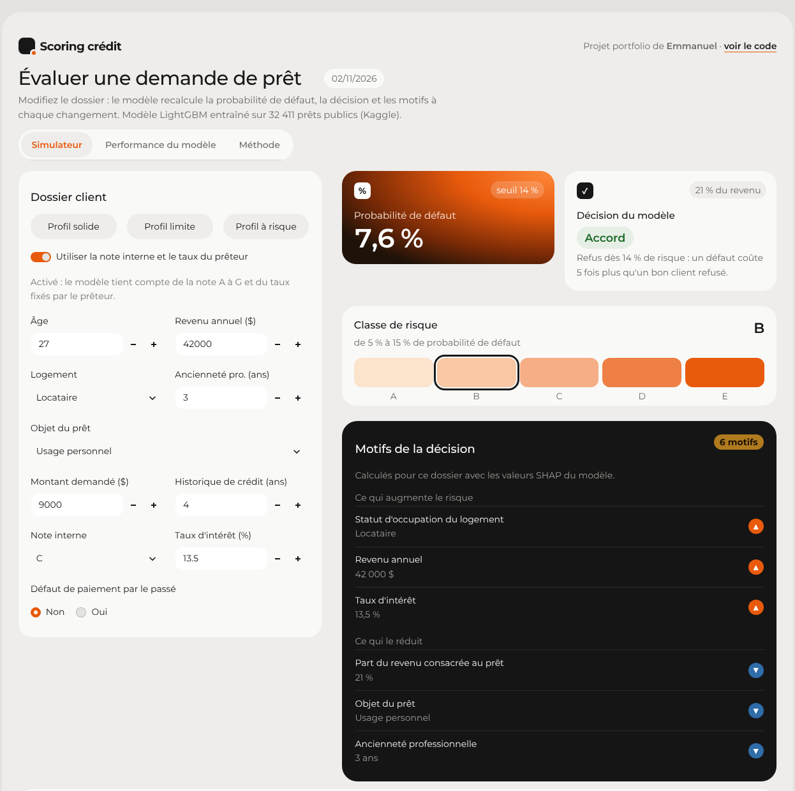
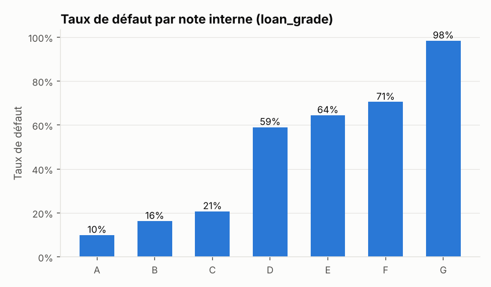
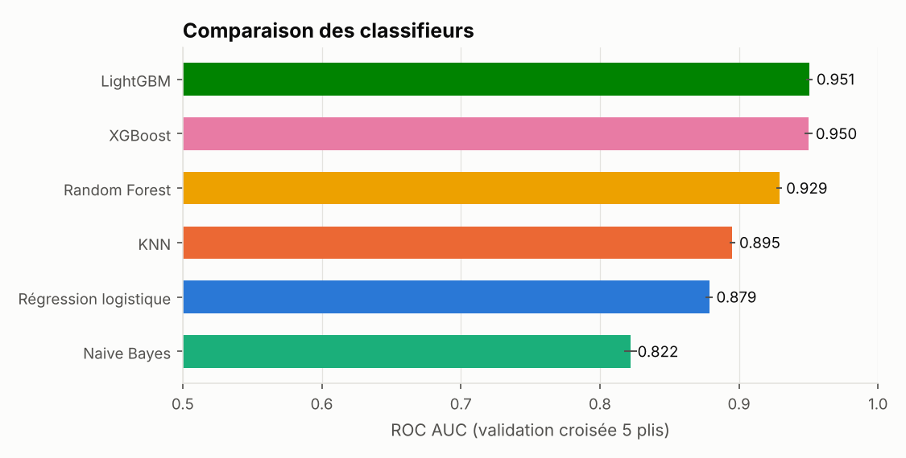
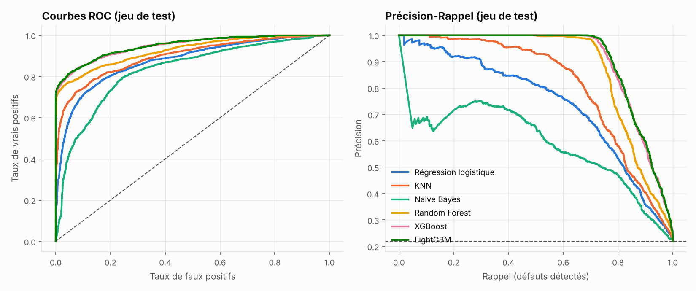
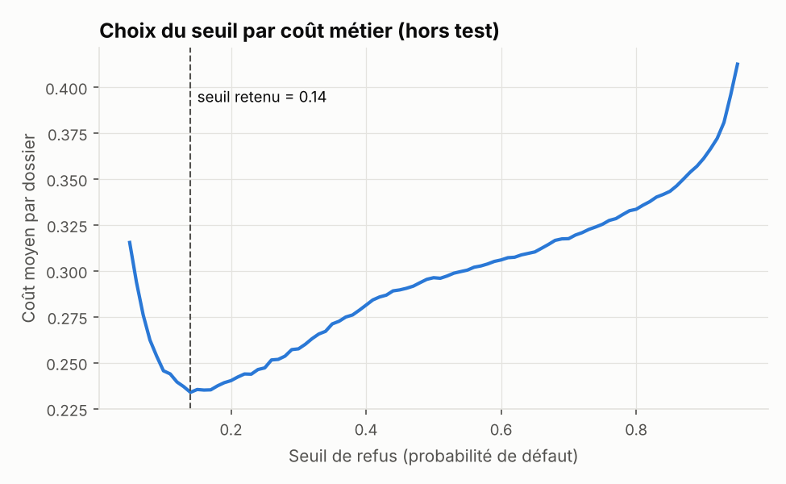
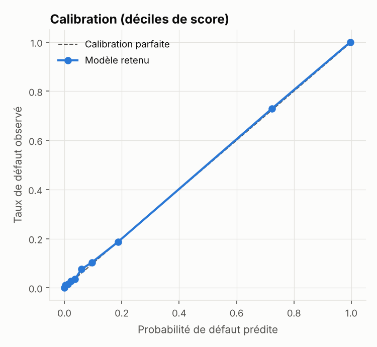
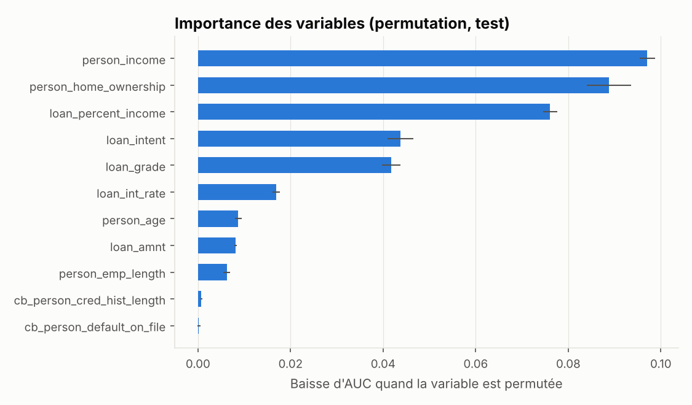
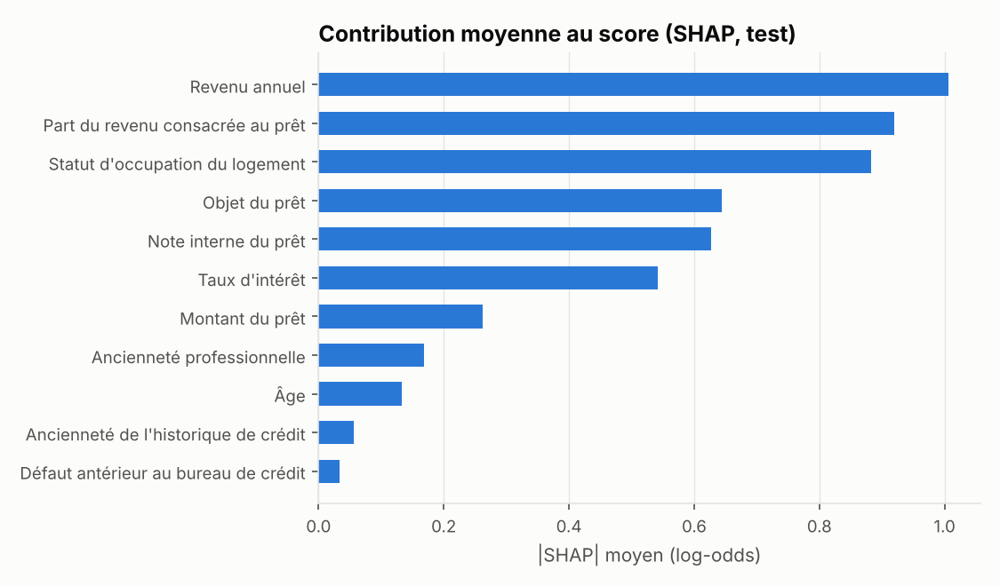
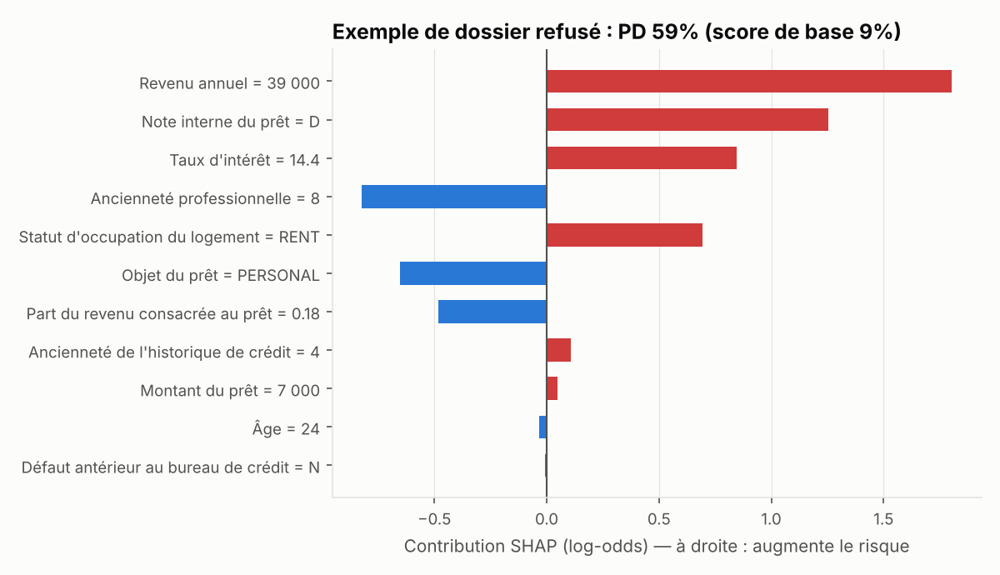

# Credit Default Classifier — Scoring du risque de défaut + API

[](https://github.com/mremmanuelgakpe-coding/credit-default-classifier/actions/workflows/ci.yml)

> **Projet 5 du portfolio Data & IA — Modélisation prédictive avec un classifieur**
> Problématique bancaire : *quels clients présentent un risque élevé de défaut sur leur prêt ?*

Six familles de classifieurs comparées sur 32 581 prêts réels (Kaggle), choix d'un seuil de décision par **coût métier**, et mise à disposition du modèle via une **API FastAPI sécurisée** conteneurisée avec **Docker**.

| | Résultat (jeu de test, 6 483 dossiers jamais vus) |
|---|---|
| Modèle retenu | **LightGBM** |
| ROC AUC / Gini | **0,950 / 0,899** |
| KS | 0,766 |
| Brier (calibration) | 0,050 |
| Au seuil retenu (PD ≥ 0,14) | 86 % des défauts détectés · taux de défaut des dossiers acceptés : **4,2 %** contre 21,9 % sans modèle |

### Essayer la démo en ligne : [(https://credit-default-classifier-mreg.streamlit.app)](#démo-streamlit)

Modifiez un dossier de prêt et voyez en direct la probabilité de défaut, la décision et les motifs qui l'expliquent.



---

## 1. Contexte et objectif

Dans une banque, accorder un prêt à un client qui ne rembourse pas coûte le capital prêté ; refuser un bon client coûte la marge d'intérêt. L'objectif est donc double :

1. **estimer une probabilité de défaut (PD) fiable** pour chaque demande ;
2. **transformer cette probabilité en décision** (accepter / refuser) en arbitrant ces deux coûts.

## 2. Données

[Credit Risk Dataset](https://www.kaggle.com/datasets/laotse/credit-risk-dataset) (licence CC0 : domaine public) — 32 581 prêts, 12 variables, **21,8 % de défauts**. Instructions de téléchargement et dictionnaire des variables : [`data/README.md`](data/README.md).



**Nettoyage documenté** (`src/credit_default/data.py`) :

| Règle | Lignes concernées |
|---|---|
| Doublons exacts supprimés | 165 |
| Âge > 100 ans (erreur de saisie) supprimé | 5 |
| Ancienneté pro > âge − 14 → valeur manquante | 2 |
| Valeurs manquantes (`loan_int_rate`, `person_emp_length`) | imputées par la médiane **dans le pipeline** + indicateur de valeur manquante |

Toutes les transformations (imputation, log des montants, standardisation, one-hot) sont dans un `Pipeline` scikit-learn ajusté uniquement sur les plis d'entraînement : **pas de fuite de données** vers la validation ou le test.

## 3. Méthodologie

```
32 411 prêts nettoyés
 ├── 80 % entraînement ── validation croisée stratifiée 5 plis
 │                         ├─ comparaison des 6 modèles (AUC, Gini, KS, PR-AUC, Brier)
 │                         └─ choix du seuil sur les prédictions out-of-fold
 └── 20 % test ─────────── évaluation finale, utilisée une seule fois
```

**Modèles comparés** : régression logistique, KNN, Naive Bayes, Random Forest, XGBoost, LightGBM.



| Modèle | AUC (CV) | Gini (CV) | KS (CV) | PR-AUC (CV) | Brier (CV) | AUC (test) |
|---|---|---|---|---|---|---|
| **LightGBM** | **0,951 ± 0,002** | 0,901 | 0,762 | 0,909 | 0,052 | **0,950** |
| XGBoost | 0,950 ± 0,003 | 0,900 | 0,759 | 0,907 | 0,053 | 0,948 |
| Random Forest | 0,929 ± 0,002 | 0,858 | 0,719 | 0,880 | 0,062 | 0,926 |
| KNN | 0,895 ± 0,002 | 0,790 | 0,642 | 0,804 | 0,091 | 0,896 |
| Régression logistique | 0,879 ± 0,003 | 0,757 | 0,624 | 0,736 | 0,100 | 0,876 |
| Naive Bayes | 0,822 ± 0,005 | 0,644 | 0,529 | 0,574 | 0,156 | 0,829 |

Les modèles de boosting dominent nettement : ils captent les interactions (ex. locataire × part du revenu consacrée au prêt) qu'un modèle linéaire ne voit pas. L'écart CV / test reste < 0,005 : pas de sur-apprentissage.



## 4. Du score à la décision : un seuil fondé sur le coût

Le seuil par défaut de 0,5 n'a aucun sens métier. On fixe une matrice de coûts relative (paramétrable dans `config.py`) : **un défaut non détecté coûte 5, un bon client refusé coûte 1**. Le seuil qui minimise le coût moyen est cherché sur les prédictions *out-of-fold* (jamais sur le test) : **0,14**.



Sur le jeu de test, à ce seuil :

| | Valeur |
|---|---|
| Défauts détectés (rappel) | 86,2 % (1 222 / 1 418) |
| Précision des refus | 66,7 % |
| Taux de refus | 28,3 % |
| Taux de défaut parmi les dossiers acceptés | **4,2 %** (vs 21,9 % sans modèle) |

**Pouvoir de discrimination par décile** : les 10 % de dossiers les plus risqués ont un taux de défaut observé de 100 % et concentrent 46 % des défauts ; les 20 % les plus risqués en capturent 79 % (`reports/deciles_full.csv`).

**Calibration** : les probabilités prédites correspondent aux taux observés (Brier 0,050), ce qui permet de les utiliser directement comme PD.

<p float="left">


</p>

L'importance par permutation (sur le test) place en tête le **revenu**, le **statut d'occupation du logement** et la **part du revenu consacrée au prêt** — des moteurs de risque cohérents avec l'intuition crédit.

## 4 bis. Explicabilité : motiver chaque décision (SHAP)

Une banque doit pouvoir expliquer **pourquoi** un dossier est refusé : au client, au conseiller, à l'audit et au régulateur. Un modèle de boosting n'est pas lisible directement comme une grille de score : chaque prédiction est donc décomposée en **valeurs SHAP**, c'est-à-dire la contribution de chaque variable au score de ce client précis.

- Calcul **exact** via le TreeSHAP natif de LightGBM (`pred_contrib`) : pas de dépendance supplémentaire en production, et la somme des contributions retrouve exactement la probabilité du modèle (vérifié par un test).
- Les colonnes techniques (one-hot, indicateurs de valeurs manquantes) sont **ré-agrégées sur les variables d'origine**, avec des libellés métier en français.



Vue globale : le revenu, la part du revenu consacrée au prêt et le statut de logement sont les principaux moteurs du score, ce qui confirme l'importance par permutation.



Lecture d'un dossier refusé (PD 59 %) : le **revenu de 39 000**, la **note D** et le **taux de 14,4 %** poussent le risque à la hausse, tandis que **8 ans d'ancienneté professionnelle** et une **part du revenu limitée à 18 %** le réduisent. C'est exactement ce que l'API renvoie dans le champ `explanation` sous forme de facteurs aggravants (`risk_factors`) et atténuants (`protective_factors`).

## 5. Analyse de sensibilité : et sans la note interne ?

`loan_grade` et `loan_int_rate` sont fixés par le prêteur **après** sa propre évaluation du risque. Les utiliser revient en partie à apprendre une notation existante. J'ai donc entraîné un second modèle « **score d'octroi** » qui n'utilise que les informations du client et de sa demande :

| Jeu de variables | AUC test | Gini | KS | Taux de défaut des acceptés |
|---|---|---|---|---|
| Complet (avec note + taux) | 0,950 | 0,899 | 0,766 | 4,2 % |
| Octroi (sans note ni taux) | 0,908 | 0,815 | 0,655 | 5,0 % |

Le modèle reste très discriminant sans la note : il ne se contente pas de recopier la notation existante. En production, c'est cette version qu'on utiliserait pour **construire** une note, la version complète servant à **affiner** la décision une fois le prix fixé. `python -m credit_default.train --feature-set application`

## 6. API de scoring (FastAPI)

| Méthode | Route | Rôle | Auth |
|---|---|---|---|
| GET | `/health` | Sonde de vie (Docker / orchestrateur) | non |
| GET | `/model-info` | Modèle, seuil, métriques, date d'entraînement | clé API |
| POST | `/predict` | Score + motifs d'un dossier (`?explain=false` pour les désactiver) | clé API |
| POST | `/predict/batch` | Score d'un lot (≤ 500 dossiers), motifs avec `?explain=true` | clé API |

```bash
curl -X POST http://localhost:8000/predict \
  -H "X-API-Key: $API_KEY" -H "Content-Type: application/json" \
  -d '{"person_age":29,"person_income":24000,"person_home_ownership":"RENT",
       "person_emp_length":1,"loan_intent":"MEDICAL","loan_grade":"C",
       "loan_amnt":9000,"loan_int_rate":14.5,"loan_percent_income":0.38,
       "cb_person_default_on_file":"Y","cb_person_cred_hist_length":3}'
```
```json
{
  "probability_default": 0.9969,
  "decision": "REFUSE",
  "risk_band": "E",
  "threshold": 0.14,
  "model_version": "lightgbm-full-2026-11-02",
  "explanation": {
    "risk_factors": [
      {"feature": "loan_percent_income", "label": "Part du revenu consacrée au prêt", "value": 0.38, "impact": 4.831},
      {"feature": "person_home_ownership", "label": "Statut d'occupation du logement", "value": "RENT", "impact": 1.5413},
      {"feature": "person_income", "label": "Revenu annuel", "value": 24000.0, "impact": 0.9178}
    ],
    "protective_factors": [
      {"feature": "loan_grade", "label": "Note interne du prêt", "value": "C", "impact": -0.3916}
    ]
  }
}
```
`impact` est la contribution SHAP en log-odds : positive, elle augmente le risque.

### Sécurité (contexte bancaire)

| Risque | Mesure |
|---|---|
| Accès non autorisé | Clé API dans l'en-tête `X-API-Key`, comparée à temps constant (`secrets.compare_digest`) ; refus si aucune clé n'est configurée côté serveur |
| Entrées malveillantes ou aberrantes | Schéma Pydantic strict : bornes numériques, valeurs autorisées (`Literal`), champs inconnus rejetés (`extra="forbid"`) |
| Artefact modifié (joblib = pickle → exécution de code) | Empreinte SHA-256 du modèle vérifiée avant chargement, refus si elle diffère |
| Fuite de données personnelles | Aucun contenu de requête journalisé ; `Cache-Control: no-store` ; données brutes exclues de Git et de l'image |
| Surface d'attaque | Swagger désactivé par défaut (`ENABLE_DOCS`) ; taille des lots plafonnée ; en-tête serveur masqué |
| Conteneur | Utilisateur non-root, code en lecture seule, `--read-only`, `--cap-drop ALL`, `no-new-privileges` |
| Secrets | `.env` ignoré par Git, `.env.example` fourni ; clé générée par `secrets.token_urlsafe(32)` |

> À ajouter avant une vraie mise en production : HTTPS (reverse proxy / load balancer), rotation des clés via un gestionnaire de secrets (AWS Secrets Manager, Azure Key Vault), limitation de débit, journal d'audit des décisions sans données personnelles.

## 7. Lancer le projet

```bash
make install                 # venv + dépendances (Python 3.11+)
make train-all               # entraîne les deux variantes, écrit models/ et reports/
make test                    # 17 tests : nettoyage, métriques, API, sécurité, SHAP, démo
make demo                    # démo Streamlit sur http://localhost:8501
                             # (ou double-clic sur lancer_demo.command sous macOS)
cp .env.example .env         # puis remplacer API_KEY par une vraie clé
make api                     # http://localhost:8000/docs
make docker-build && make docker-run
```

### Démo Streamlit

**Lancer en local sur Mac** : double-cliquer sur `lancer_demo.command`. Au premier lancement, il installe un environnement dédié (`.venv-demo`, ignoré par Git), puis ouvre le navigateur sur un port libre à partir de http://localhost:8505 (pour ne pas entrer en conflit avec une autre app Streamlit). Si macOS bloque le fichier, faire clic droit → *Ouvrir*.

La démo (`demo/app.py`) charge directement le modèle, sans passer par l'API : aucune clé n'est exposée publiquement et aucune donnée saisie n'est enregistrée. L'empreinte du modèle est vérifiée au chargement, comme dans l'API.

Mise en ligne gratuite sur [Streamlit Community Cloud](https://share.streamlit.io) : 
1. Pousser le projet sur GitHub (dépôt public). Les fichiers `models/*.joblib` et `reports/` doivent être versionnés ; les données brutes restent exclues.
2. Sur share.streamlit.io : *Create app* → choisir le dépôt, la branche `main` et le fichier `demo/app.py`.
3. Dans *Advanced settings*, choisir **Python 3.12**. Les dépendances sont lues dans `demo/requirements.txt`.
4. Remplacer `GITHUB_URL` en haut de `demo/app.py` par l'URL du dépôt, puis le lien de la démo en haut de ce README.

## 8. Structure

```
05-credit-default-classifier/
├── api/main.py                  # API FastAPI sécurisée
├── demo/app.py                  # démo Streamlit (simulateur + performance)
├── demo/static/fonts/           # Montserrat (licence OFL), servie localement
├── lancer_demo.command          # lancement de la démo en un double-clic (macOS)
├── .streamlit/config.toml       # thème de la démo
├── src/credit_default/
│   ├── config.py                # chemins, variables, coûts métier
│   ├── data.py                  # chargement, contrôle SHA-256, nettoyage
│   ├── models.py                # prétraitement + 6 classifieurs
│   ├── metrics.py               # AUC, Gini, KS, Brier, seuil par coût, déciles
│   ├── explain.py               # valeurs SHAP + motifs de décision
│   ├── plots.py                 # figures
│   └── train.py                 # pipeline complet (CLI)
├── models/                      # model_*.joblib + métadonnées (hash, seuil, métriques)
├── reports/                     # metrics_*.json, comparaisons, déciles, figures
├── tests/                       # pytest
├── Dockerfile · Makefile · requirements*.txt · MODEL_CARD.md
```

## 9. Limites et suites

- Données publiques d'origine non documentée (pas de dates) : pas de validation *out-of-time*, qui serait la norme en banque.
- Les seuils des classes de risque A → E de l'API sont illustratifs.
- Les valeurs SHAP expliquent le **modèle**, pas une causalité : « revenu faible » est un motif statistique, pas une preuve individuelle.
- Pistes : suivi de la **stabilité (PSI)** des variables et du score en production, déploiement sur Cloud Run / Azure Container Apps, CI GitHub Actions (tests + build de l'image).

---
**Stack** : Python · pandas · scikit-learn · XGBoost · LightGBM · SHAP (TreeSHAP) · FastAPI · Pydantic · Streamlit · Docker · pytest
